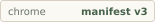
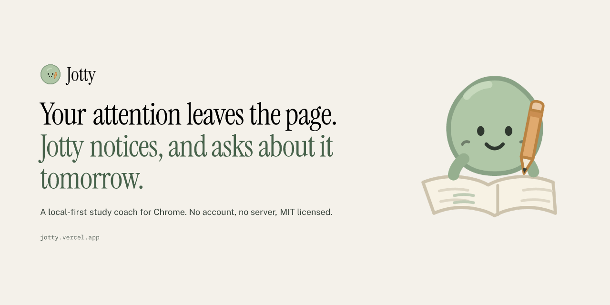
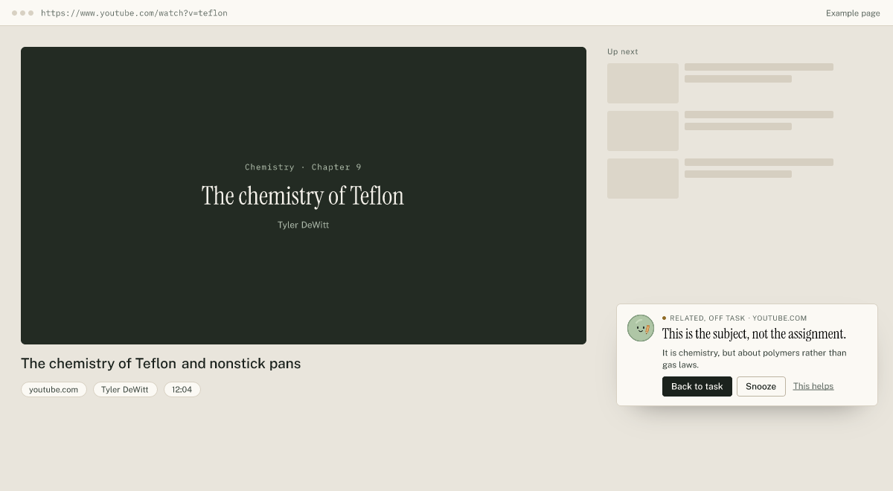
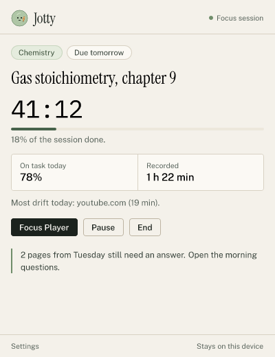
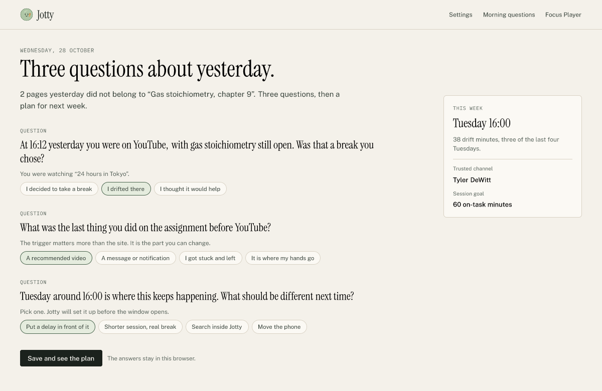
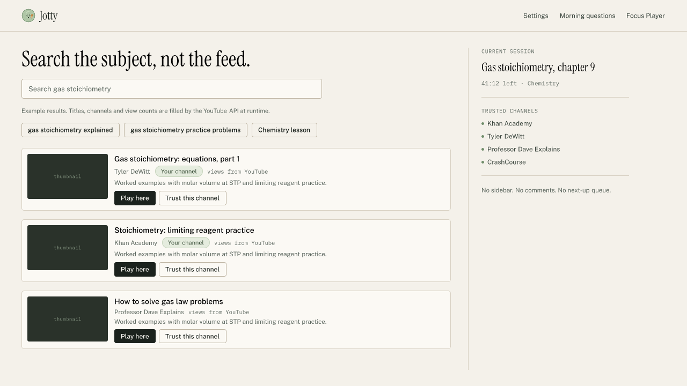
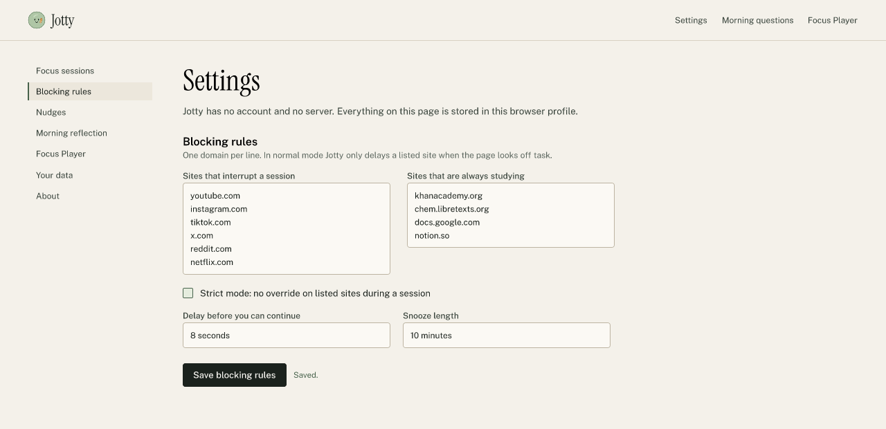
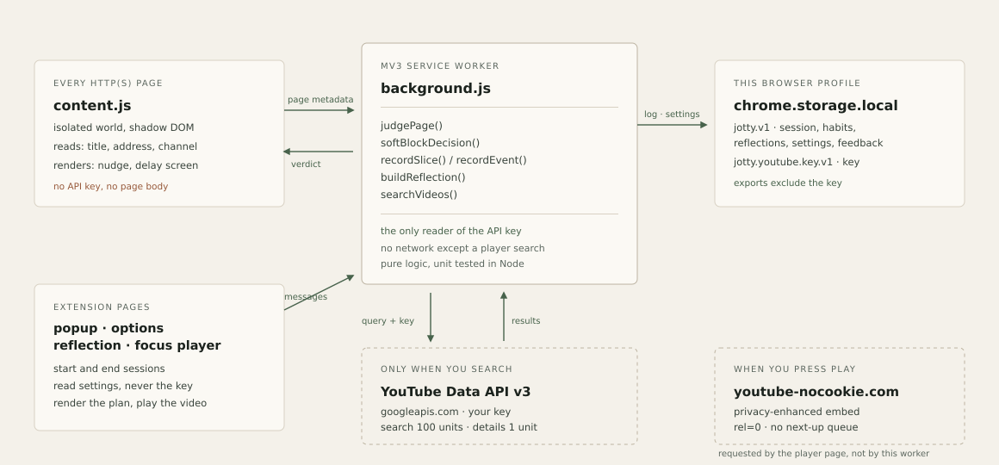

<div align="center">


# Jotty

**AI study focus coach for Chrome. It judges the page in front of you against the task you set, nudges you back when you drift, and asks about it the next morning.**

[](https://jotty.vercel.app)
[](#what-runs-where)
[](#privacy-and-permissions)
[](#privacy-and-permissions)
[](#development-build-and-test)
[](LICENSE)

[**Live site and working demos**](https://jotty.vercel.app) · [**Download v1.0.0 (.zip)**](https://jotty.vercel.app/releases/jotty-v1.0.0.zip) · [**60-second install**](#install-unpacked-in-60-seconds) · [**How the judge works**](#how-the-judge-works-deep-dive) · [**Privacy policy**](https://jotty.vercel.app/privacy-policy.html)

<br />

<a href="https://jotty.vercel.app">
  
</a>

</div>

---

## Live demos

The website runs three of the extension's real modules with example data:

1. **The relevance judge.** Change the page in the hero panel and watch the same `judgePage()` function that ships inside the extension return on task, related off task, or off task, with its evidence.
2. **The morning reflection.** Answer three questions generated from a fixed example Tuesday, then see the plan the real `evaluateReflection()` function produces.
3. **The weak spot heatmap.** Switch between drift and on-task minutes across four example weeks. The grid is built by the same `buildHeatmap()` and `rankWeakSpots()` functions the extension uses.

Nothing on the site leaves your browser. The demo engine is bundled from `src/` by `npm run build`, not reimplemented in the page.

---

## Why this exists

Most study drift is not a dramatic failure. It is one reasonable click into a page that is *almost* the right page. A blocker cannot tell the difference between the assignment and the subject, so it either blocks the help or gets switched off.

| Task you set | Page in front of you | What Jotty calls it | What happens |
| :--- | :--- | :--- | :--- |
| Gas stoichiometry, chapter 9 | *Gas stoichiometry: equations, part 1* | **On task** | Nothing. Time counts toward the task. |
| Gas stoichiometry, chapter 9 | *The chemistry of Teflon and nonstick pans* | **Related, off task** | A nudge names the gap: chemistry, but polymers rather than gas laws. |
| Gas stoichiometry, chapter 9 | *24 hours in Tokyo* | **Off task** | A nudge. A delay screen if YouTube is on your site list. |
| Nothing running | Any page | **No session** | Nothing is judged and nothing is logged. |

The difference between row one and row two is the product. It is why the extension can keep YouTube, and why the nudge has something specific to say.

---

## Interface

These are interface previews of the shipped popup, nudge, reflection, player and settings, composed from the same palette, type scale and copy as `src/`. They are rendered by `tools/build-previews.mjs`; the site's demos run the underlying logic live.

### 1. The corner nudge on a YouTube watch page

An isolated Shadow DOM card names the drift, shows one line of evidence, and offers three exits: back to task, snooze, and a feedback button. It is not modal and it never closes the tab for you.

<div align="center">
  
</div>

### 2. The toolbar popup

Task, subject, deadline, countdown, today's on-task share, and the two things you actually need mid-session: the Focus Player and the end button.

<div align="center">
  
</div>

### 3. The morning reflection

Three questions built from yesterday's real timestamps, site names, page titles and the four-week pattern, followed by one plan. No score, no streak, no guilt copy.

<div align="center">
  
</div>

### 4. The Focus Player

Search happens in Jotty. Trusted channels are ranked first, clips under ninety seconds are hidden, and playback uses the privacy-enhanced embed with no sidebar and no next-up queue.

<div align="center">
  
</div>

### 5. Settings

Site lists, strict mode, delay length, nudge behaviour, reflection hour, per-subject channels, the YouTube key, quota readout, export and deletion.

<div align="center">
  
</div>

---

## Real-world use cases

1. **The chemistry detour.** You need one stoichiometry video and the sidebar offers a beautiful explainer about Teflon. Jotty recognises the subject match and the topic mismatch, so the nudge says exactly why the page is not the assignment.
2. **The 4pm collapse.** The heatmap ranks repeated windows by drift, not by total screen time. One late night is noise; three Tuesdays at 16:00 is a pattern worth designing around.
3. **The useful video.** You genuinely need a video, so you search inside the Focus Player instead of YouTube. Same explanation, no recommendation column, no autoplay queue.
4. **The honest break.** You planned to stop at 16:00. The reflection asks whether the break was chosen. If it was, Jotty leaves it alone and the plan moves elsewhere.
5. **Strict week.** Deadlines are close. Strict mode turns listed sites into an eight-second delay with no override. The only exit is ending the session, which is a decision rather than a reflex.
6. **The shared laptop.** No account, no sync, no server. Delete the data from Settings and the log, reflections and API key are gone.

---

## Install unpacked in 60 seconds

### Option A: download the release (no Node.js)

1. Download **`jotty-v1.0.0.zip`** from [jotty.vercel.app](https://jotty.vercel.app/releases/jotty-v1.0.0.zip) or the GitHub Releases page, and unzip it.
2. Open `chrome://extensions` in Chrome, Brave, Arc or Edge and enable **Developer mode**.
3. Click **Load unpacked** and select the unzipped folder, the one with `manifest.json` at its root.

### Option B: build from source

```bash
git clone https://github.com/sarang-cmd/jotty.git
cd jotty
npm install
npm run build
npm test
npm run site   # http://localhost:4173
```

Then load the **`extension/`** folder via **Load unpacked**. The release ZIP is produced with `npm run zip`.

### After install

1. Open the popup and type a task that names the assignment, not just the subject.
2. Start a session. The content script judges pages only while a session is active.
3. Optional: add a YouTube Data API key in Settings for player search. The [key guide](https://jotty.vercel.app/guides/youtube-data-api-key/) covers the referrer restriction that silently breaks extensions.

---

## What runs where

<div align="center">
  
</div>

### Permissions

| Permission | Why it exists |
| :--- | :--- |
| `storage` | Session, habit log, reflections, settings. The entire product state. |
| `alarms` | Session end and the single daily reflection reminder. No polling. |
| `notifications` | One optional morning notification and one when a session ends. |
| `https://www.googleapis.com/*` | YouTube Data API, used only when you start a Focus Player search. |
| Content script on http and https pages | Needed to judge the current page during a session. It reads the title, the address and the YouTube channel name. |

The extension has **no `<all_urls>` host permission**. It has a content script on `<all_urls>` because that is the only way to know what page you are on during a session; `host_permissions` stays narrow. With no session running, nothing is judged or logged.

### API key isolation

`getApiKey()` throws unless `globalThis.__JOTTY_SERVICE_WORKER__ === true`. The flag is set in exactly one file, `src/background/service-worker.js`. `tests/security.test.js` fails if any other module imports the reader, if a content script calls `fetch`, if the landing page adds a remote script or an analytics host, or if `host_permissions` grows beyond the YouTube API.

---

## How the judge works (deep dive)

### 1. Inputs

The judge receives four strings and the current session:

```js
{
  title: "The chemistry of Teflon and nonstick pans",
  url: "https://www.youtube.com/watch?v=teflon",
  channel: "Tyler DeWitt",
  description: "How PTFE is made and why nothing sticks to it."
}
```

No page body, no DOM walk, no transcript, no network request. On non-YouTube pages the channel is empty and the description meta tag is used as a weak signal.

### 2. Text work

`src/lib/text.js` folds case, strips punctuation, removes stopwords, and applies a light stemmer so `gases` matches `gas` and `reactions` matches `reaction`. The task line keeps multi-word phrases (`gas stoichiometry`) because a phrase hit is worth three keyword hits.

### 3. Subject clusters

`src/config/subjects.js` describes eight subjects (chemistry, biology, physics, math, computer science, history, economics, literature), each split into topic clusters with real vocabulary. Chemistry, for example:

| Cluster | Sample terms |
| :--- | :--- |
| `gases` | gas, ideal gas, pv=nrt, partial pressure, mole, stoichiometry, limiting reagent, avogadro |
| `polymers` | polymer, teflon, ptfe, plastic, monomer, polyethylene, nylon |
| `organic` | alkane, alkene, functional group, isomer, chirality |
| `acids` | acid, base, ph, buffer, titration |

Both the task and the page are mapped to a subject and a cluster. That is how *chemistry about Teflon* becomes **related, off task** during a *gas stoichiometry* session, while *chemistry about ideal gases* becomes **on task** even if it never repeats the exact words.

### 4. Scoring and verdicts

| Condition | Verdict | Confidence |
| :--- | :--- | :--- |
| A task phrase appears in the metadata | On task | 0.93 |
| Two or more task keywords appear | On task | 0.82 |
| Same subject and same cluster as the task | On task | 0.78 |
| Same subject, different cluster | Related, off task | 0.72 to 0.80 |
| A social or YouTube page with no subject match | Off task | 0.86 |
| An unrelated document | Off task | 0.58 |
| No active session | No session | 0 |

Every verdict also carries `signals` (what matched, with weights) and `reasons` (the sentence a person reads). The nudge shows one reason; the demo shows all of them.

### 5. From verdict to action

- `shouldNudge()` requires an active nudge setting, a non-neutral verdict, and either "related, off task" or an off-task call with confidence of at least 0.70.
- `softBlockDecision()` blocks a listed domain in strict mode, or when the page is off task. It never blocks an allowlisted domain, even in strict mode.
- The content script measures visible time in 30-second ticks and records drift minutes per domain and hour. It holds a snooze map per host, so a snooze is local to the tab session.

### 6. Morning reflection

`buildReflection()` reads yesterday's flagged events, picks the most recent off-task primary, finds any adjacent page, and writes three or four questions:

- **Intention:** the exact time, site, task and page title.
- **The moment before:** the trigger, not the site.
- **The useful detour:** only when an adjacent page exists.
- **Repair:** the weekday and hour ranked by `rankWeakSpots()` over four weeks.

Question choice is seeded with `hashString("jotty:" + date)` so a reload does not reshuffle the conversation. `evaluateReflection()` counts drift, planned and needed answers and returns one insight plus one to three plan items.

### 7. Habit log

```js
{
  "days": {
    "2026-10-27": {
      "hours": [{ "onTask": 0, "offTask": 0 }],   // 24 entries
      "domains": { "youtube.com": { "seconds": 420, "offTask": 420 } },
      "flagged": 2
    }
  },
  "events": [{ "ts": 1793117040000, "domain": "youtube.com", "verdict": "adjacent" }]
}
```

Days older than ninety days are pruned. Events are capped at 400. The heatmap aggregates by Monday-first weekday and hour, and weak spots require at least one minute of drift in a cell.

### 8. Focus Player

Search runs in the service worker against `https://www.googleapis.com/youtube/v3` with the user's key:

1. `search.list` with `type=video`, `videoEmbeddable=true`, `safeSearch=strict` (100 units).
2. `videos.list` for duration and view count (1 unit).
3. Results are ranked: trusted channel first, then view count. Anything under 90 seconds is removed.
4. Playback uses `youtube-nocookie.com/embed/<id>?rel=0&modestbranding=1&playsinline=1&iv_load_policy=3`.

Search results are cached in memory for thirty minutes. Quota use is counted and shown in Settings. If no key exists, the player says so and shows the channel list instead of pretending to search.

---

## Blueprint to recreate this pattern

1. **Write the decision as a pure function.** `judgePage(page, { session, settings })` takes plain objects and returns a plain object. No chrome APIs, no DOM, no fetch. It runs under `node --test` in milliseconds.
2. **Keep a small, readable vocabulary.** A subject lexicon of a few hundred terms is enough to separate *subject* from *assignment*. It is auditable, offline and deterministic.
3. **Make every verdict explain itself.** Return the evidence (`signals`) and a human sentence (`reasons`). A nudge without evidence is just nagging.
4. **Separate the worlds.** Content script for reading metadata and rendering UI; service worker for storage, keys and the only network call; extension pages for configuration.
5. **Store by day, hour and domain.** A flat event list alone cannot answer "when does this usually happen?" without replaying everything.
6. **Generate reflection questions from data.** Use the real timestamp, the real title, and the ranked weak spot. Seed the selection so the conversation is stable.
7. **Test the privacy claim.** A source-level test that fails when a key reader moves or a remote script appears is worth more than a paragraph in a policy.

---

## Repository structure

```text
.
├── build.mjs                       # esbuild: worker (ESM), content + pages (IIFE), demo engine
├── serve-docs.mjs                  # zero-dependency preview server on 0.0.0.0:4173
├── vercel.json                     # static deploy from docs/, cache + zip headers
├── package.json                    # zero runtime dependencies; esbuild and build tools only
├── extension/                      # ready-to-load MV3 extension
│   ├── manifest.json               # storage, alarms, notifications + youtube host permission
│   ├── popup.html                  # toolbar quick controls
│   ├── options.html                # sessions, rules, nudges, reflection, player, data
│   ├── reflection.html             # morning questions
│   ├── focus.html                  # Focus Player
│   ├── theme.css                    # shared interface styles and tokens
│   ├── fonts/                      # bundled OFL woff2 files
│   └── icons/                      # 16, 32, 48, 128 px PNG marks
├── src/
│   ├── config/subjects.js          # subject lexicon, clusters, curated channels, domains
│   ├── background/service-worker.js# messages, alarms, storage, YouTube calls, key reader
│   ├── content/
│   │   ├── content.js              # page metadata, verdict handling, time ticks
│   │   ├── toast.js                # Shadow DOM corner nudge
│   │   └── block.js                # Shadow DOM delay screen with focus trap
│   ├── popup/popup.js              # session start/pause/end, countdown, quick links
│   ├── options/options.js          # settings forms, key save/test/clear, export, wipe
│   ├── reflection/reflection.js    # question rendering and plan display
│   ├── focus/focus.js              # player search, ranking, clean embed
│   ├── demo/engine.js              # the bundle exported to the website demo
│   ├── ui/theme.css                # source for extension/theme.css
│   ├── ui/mark.js                  # inline mascot and arrow for shadow DOM
│   └── lib/
│       ├── relevance.js            # judge, nudge and block decisions
│       ├── habits.js               # slices, events, heatmap, weak spots, streaks
│       ├── reflection.js           # question writer and answer evaluator
│       ├── focus.js                # API request builders, ranking, embed URL, errors
│       ├── youtube-api.js          # fetch wrapper; receives the key, never reads storage
│       ├── session.js              # clock arithmetic
│       ├── storage.js              # one versioned object + guarded key reader
│       └── text.js                 # tokenising, stemming, dates, durations
├── tests/                          # 66 Node tests: logic, storage, security, pipeline
├── tools/
│   ├── build-assets.mjs            # rasterises icons, favicons, badges
│   ├── build-previews.mjs          # renders README and store previews with satori
│   ├── check-docs.mjs              # link, asset, a11y and copy checks for docs/
│   └── render-svg.mjs              # small SVG to PNG helper
├── store-assets/                   # Chrome Web Store icon, promo tile and 1280x800 previews
└── docs/                           # static site -> https://jotty.vercel.app
    ├── index.html                  # landing page with three live demos
    ├── styles.css                  # warm paper design system
    ├── site.js                     # demo wiring; no third-party code
    ├── assets/
    │   ├── engine.js               # generated demo bundle
    │   ├── logo.svg, icon.svg      # mascot and simplified mark
    │   ├── fonts/                  # self-hosted woff2 (no font CDN)
    │   ├── screenshots/            # interface previews used above
    │   ├── architecture.svg
    │   └── badges/
    ├── guides/                     # hub + five field guides
    ├── releases/                   # jotty-v1.0.0.zip
    ├── privacy-policy.html         # policy, permissions table, retention
    ├── terms.html                  # terms, draft for review
    ├── font-licenses.html          # SIL OFL 1.1 notices
    ├── 404.html
    ├── sitemap.xml, robots.txt, llms.txt, site.webmanifest
    ├── PRIVACY_POLICY.md           # Markdown source of the policy
    └── FONT-LICENSES.md
```

---

## Development, build and test

```bash
npm install
npm run build      # bundles src/ into extension/ and docs/assets/engine.js
npm test           # 66 tests: logic, storage, security, end-to-end pipeline
npm run site       # http://localhost:4173
npm run check      # link, asset, label and copy checks for docs/
npm run assets     # regenerate icons, favicons and badges from the SVG marks
npm run previews   # regenerate README and store previews with satori + resvg
npm run zip        # build, then package extension/ into jotty-v1.0.0.zip
```

### What the tests cover

| File | Scope |
| :--- | :--- |
| `relevance.test.js` | Task phrases, subject adjacency, allowlist, confidence, nudge and block decisions, malformed URLs |
| `habits.test.js` | Slice recording, daily summary, Monday-first heatmap, weak spot ranking, pruning, streak |
| `reflection.test.js` | Question generation, stable ordering, adjacent questions, plan selection, empty day |
| `focus.test.js` | API URLs and parameters, ISO durations, view formatting, trusted ranking, shorts filter, no-cookie embed |
| `session.test.js` | Clock arithmetic across pause/resume/end, countdown, deadlines |
| `storage.test.js` | Defaults, normalisation, key isolation, export excludes the key, quota reset, wipe |
| `security.test.js` | Only the worker reads the key; content scripts make no requests; no remote scripts or analytics; narrow host permissions |
| `pipeline.test.js` | A Tuesday session becomes slices, events, a Wednesday reflection and a plan |

### What was tested, and what was not

- **Tested:** all 66 Node tests; the build and bundle sizes; every internal link and asset with `npm run check`; the static server and every page response with `curl`; the rendered preview images and mascot at multiple sizes; the demo engine's output against the same functions used in the tests.
- **Not tested in this environment:** a real Chrome install with the extension loaded, because the sandbox has no browser binary. There are no automated DOM or screenshot tests. The layout was written against the shipped CSS and reviewed through the rendered previews, not through a browser viewport. Load it unpacked before trusting it for a term.
- **Not verified:** availability of the name Jotty, a Chrome Web Store listing, or a production domain. The site currently assumes `jotty.vercel.app`.

---

## Guides

- [A morning reflection that changes next week](https://jotty.vercel.app/guides/morning-reflection/)
- [Study on YouTube without the sidebar](https://jotty.vercel.app/guides/youtube-without-the-feed/)
- [Create a free YouTube Data API key](https://jotty.vercel.app/guides/youtube-data-api-key/)
- [Write a task line the judge can use](https://jotty.vercel.app/guides/focus-session-setup/)
- [What Jotty stores, in plain language](https://jotty.vercel.app/guides/what-jotty-stores/)

---

## Privacy and permissions

- **No backend, no analytics, no account.** The extension has no developer server to send data to.
- **Local storage only.** `chrome.storage.local` holds sessions, habit slices, flagged events, reflections, settings and feedback.
- **Two network requests, both user-initiated.** A Focus Player search sends the query and key to `googleapis.com`; pressing play requests the embed from `youtube-nocookie.com`.
- **The API key is isolated.** It is stored separately, read only by the service worker, and excluded from exports.
- **Full policy:** [jotty.vercel.app/privacy-policy.html](https://jotty.vercel.app/privacy-policy.html) and [`docs/PRIVACY_POLICY.md`](docs/PRIVACY_POLICY.md). Terms: [`docs/terms.html`](https://jotty.vercel.app/terms.html), currently a draft for review.

---

## Design notes

- **Direction:** warm paper, ink, one moss accent and a sage mascot. The interface borrows the restraint of a product page rather than the vocabulary of a SaaS template: no gradient orbs, no glass panels, no icon grid, no three-card feature row.
- **Type:** Instrument Serif for display and questions, Public Sans for reading, IBM Plex Mono only for clocks, dates and quantities. All self-hosted under the SIL OFL. No Inter, Geist, Space Grotesk or icon font.
- **Tools:** the site is static HTML, CSS and vanilla JavaScript because that is the smallest thing that supports the brief. Radix Primitives and Motion were considered and deliberately not shipped: both expect React or a runtime this page does not have, and the few components needed (a disclosure list, a focus-trapped delay screen, a toast with a status role) are implemented natively with the same accessibility rules. The demo panels keep one state object, update it through named transitions, and respect `prefers-reduced-motion`, which is the part of the Motion approach that mattered here.
- **Previews:** the five interface images are vector compositions rendered from the shipped palette and type by `tools/build-previews.mjs`. They are labelled as previews on the website. Nothing in them claims a fake statistic; sample view counts are intentionally left to the API.

---

## Font licenses

Public Sans, Instrument Serif and IBM Plex Mono are bundled locally under the SIL Open Font License 1.1. Copyright notices and the full license text are in [`docs/FONT-LICENSES.md`](docs/FONT-LICENSES.md) and [font-licenses.html](https://jotty.vercel.app/font-licenses.html).

---

## Disclaimer

Jotty is an independent open-source project. It is not affiliated with, endorsed by, or sponsored by YouTube, Google, or any school. YouTube is a trademark of Google LLC. The Focus Player uses YouTube API Services; your use of it is also subject to the [YouTube Terms of Service](https://www.youtube.com/t/terms) and the [Google Privacy Policy](https://policies.google.com/privacy).

The relevance judge is a text comparison, not a tutor. It will sometimes be wrong. The product is designed so that being wrong costs one click, not your data.

## License

[MIT](LICENSE) © 2026 sarang-cmd
